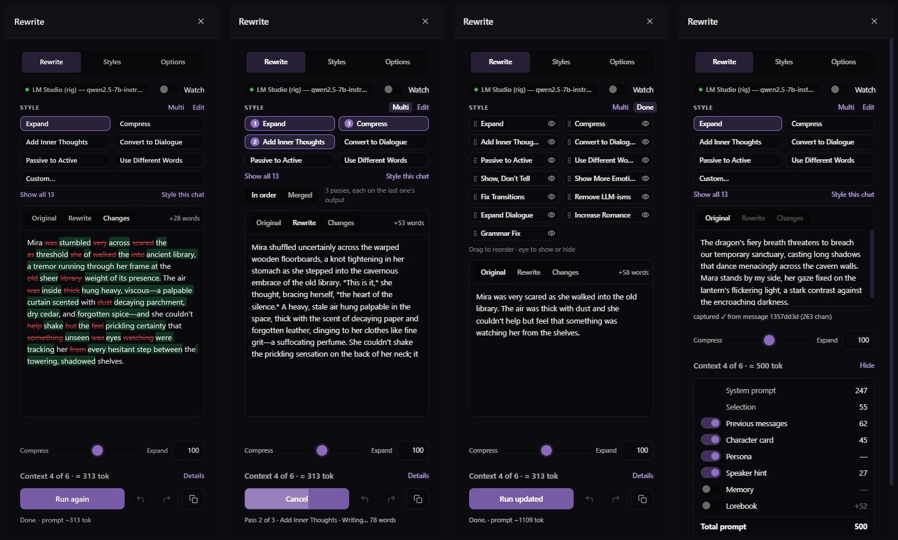

# Rewrite

A [Lumiverse](https://github.com/lumiverse) Spindle extension that rewrites selected message
text **in place** with an LLM style profile. Highlight a passage, pick a style, hit Run — the
rewrite streams in, and Apply splices it back into the exact span you selected, leaving the rest
of the message untouched.

It runs entirely against your own configured connections, so you can write the main chat with
one model and rewrite prose with another (e.g. a fast local model for quick edits).



## Features

**Rewriting**
- **Streaming** — the rewrite appears word by word as the model writes it, with a live word count.
- **One text card** that switches between **Original**, **Rewrite** and **Changes** (a word-level
  diff that stays readable on long, multi-paragraph selections) and fills the panel down to Run.
- **One main button** — Run, Cancel while it runs (filling up as passes complete), then Apply once a
  result for your selection is ready. It reads **Run updated** once you change the style, context,
  length or text after a run.
- **Length slider** — Compress on the left (down to 25%), 100% in the middle, Expand on the right
  (up to 400%); the number box takes exact values.
- **Point of view holds** — first- and second-person passages stay that way ("I walked" doesn't
  become "He strolled").

**Styles**
- 13 built-in styles (expand, compress, add inner thoughts, show-don't-tell, remove LLM-isms, …),
  your own saved styles, and a per-chat **Style this chat** voice generated from the character card.
- A compact grid: three rows by default with **Show all**. **Edit** lets you drag styles into your
  own order and hide any of them.
- **Multi** — pick several styles for one run. **In order** runs one pass per style, each on the
  previous pass's output; **Merged** combines them into one instruction and runs once.
- One-off **Custom…** instructions with AI **Refine** and a recent-prompts history.
- The **Styles** tab holds your styles: create, edit, delete, write one with AI from a
  description, and hide built-ins.

**Capture & apply**
- **Watch mode** auto-captures whatever you highlight in a message; `Alt+R` captures on demand.
- Corruption-safe in-place splice (render→raw alignment with an authoritative guard) so the
  rewrite lands exactly where you selected and nowhere else.
- **Formatting-preserving** — `<font>` colours and markdown (`*italics*`, quotes, links) inside
  the selection survive the rewrite.
- **Multi-message** rewrite: select across several bubbles and rewrite each in one run.
- Multi-level **undo/redo** with a configurable history depth; optional auto-apply.

**Context & cost**
- **Details** lists every context source — previous messages, character card, user persona,
  speaker hint, memory, lorebook — with its own switch and token cost. A source you've switched off
  shows what it would add. Sources you haven't granted permission for are simply skipped.
- Per-rewrite **connection** choice (Options), **generation parameters** (temperature, top-P,
  top-K, max tokens, penalties; blank inherits the preset), and a **request timeout** (10–600s).
- Settings and undo history are stored **per user**, so shared Lumiverse installs don't mix them.
- Settings export/import, reset to defaults, and a debug-log export.

## Install

This extension ships pre-built bundles in `dist/`. To use it in Lumiverse:

- **From the app:** install it through Lumiverse's extension manager using this repository's URL, **or**
- **Manually:** unzip the release into your Lumiverse extensions directory and restart the backend.

Requires Lumiverse **1.1.0** or newer. The extension
requests these permissions (declared in `spindle.json`): `generation`, `chat_mutation`,
`characters`, `personas`, `memories`, `world_books`. Context sources you don't grant are skipped.

## Build from source

Requires [Bun](https://bun.sh).

```sh
bun install
bun run build      # → dist/backend.js, dist/frontend.js (minified)
bun run typecheck  # tsc --noEmit
bun test           # unit tests: alignment, diff, profiles, settings, style order, length scale, …
```

`dist/` is committed so the extension is installable without a build step; rebuild after changing
anything under `src/`.

## Credits

The original browser extension lives at
[Beeopo/Marinara-Rewrite](https://github.com/Beeopo/Marinara-Rewrite) (the Marinara Engine
"Rewrite-Assistant"). This is a from-scratch rebuild of it as a native Lumiverse Spindle
extension — backend worker + in-host frontend panel.

## License

MIT — see [LICENSE](LICENSE). Copyright (c) 2026 Beeopo.
